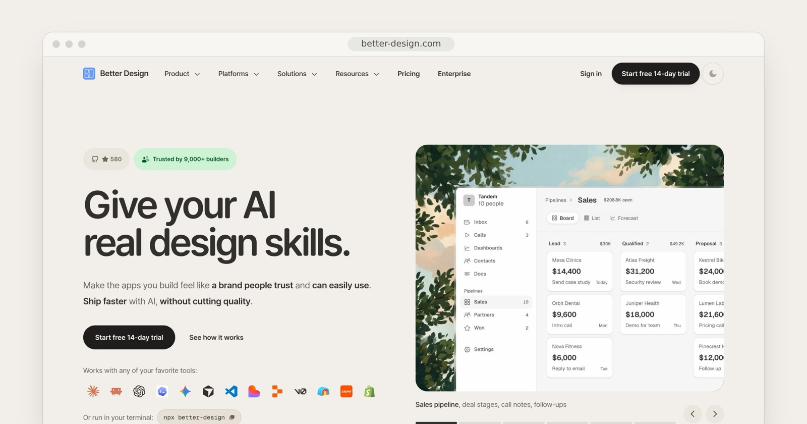

<a href="https://better-design.com/?utm_source=github&utm_medium=readme&utm_campaign=snow-town"></a>

> **Want to build something like this in the future? [Use our MCP!](https://better-design.com/?utm_source=github&utm_medium=readme&utm_campaign=snow-town)**

# Snow town

A tiny snow town you can drive through in the browser, phone included.

**[Play it](https://snow-town-smoky.vercel.app/?utm_source=github&utm_medium=readme&utm_campaign=snow-town)**

- Hold your finger (or the mouse) on the snow and the car drives there.
- On a computer, the arrow keys or WASD steer too, and Down reverses.
- Swap the car for a ball.
- Every move leaves tracks in the snow.

Built with three.js, WebGPU and TSL, with a WebGL fallback for older Safari.

## Run it

```bash
npm install
npm run dev
```

Then open http://127.0.0.1:5190.

## Credits

Car model: [Car Concept](https://github.com/KhronosGroup/glTF-Sample-Assets/tree/main/Models/CarConcept), Khronos Group, after a public-domain model by Unity Fan. [CC BY 4.0](https://creativecommons.org/licenses/by/4.0/).
